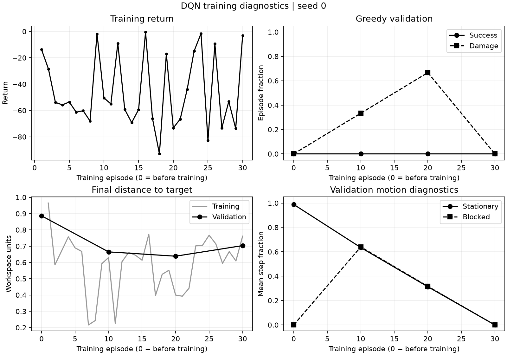

# Attempt 001: DQN from scratch in the multi-route scene

**Status:** completed, unsuccessful at learning the task.

**Run identifier:** `multiroute_pilot_20261110`.
**Record date:** 10 November 2026. This note was reconstructed from retained
artifacts; a precise launch timestamp was not saved.

## Question and scope

The new scene contains three branch regions, alternating open passages,
deformable narrow passages and a rigid closed passage. An agent must make
several route decisions rather than cross a single gap. This pilot asks whether
the existing DQN can begin solving that scene without changing the reward or
network architecture. It also checks whether failure can be explained by
unreachable scenes or by unproductive policy behavior.

The scene uses 14 branches, 341 observation features, eight discrete motion
actions and a 200-action budget. Reset-time reference verification is enabled
for training. A separate audit disables that filter and tests raw geometrically
valid scenes to avoid reporting only scenes already accepted by the planner.

## Setup and reproduction

Run commands from the repository root using the environment in
`environment.yml`. The historical run used the local `.venv/Scripts/python.exe`
interpreter. The commands below use `python` from the activated equivalent
environment. A new output directory is required; the training script refuses
to overwrite an existing run.

```powershell
python -u scripts/train_dqn.py --config configs/environment_multiroute.yaml --dqn-config configs/dqn_multiroute_pilot.yaml --training-config configs/training_multiroute_pilot.yaml --output-dir results/training/multiroute_pilot_20261110
python scripts/summarize_training.py --run-dir results/training/multiroute_pilot_20261110
python scripts/check_scene_feasibility.py --config configs/environment_multiroute.yaml --seed 0 --count 30 --output results/multiroute/feasibility_30.json
```

The final greedy checkpoint can be re-evaluated with:

```powershell
python scripts/evaluate_dqn.py --checkpoint results/training/multiroute_pilot_20261110/best.pt --episodes 3 --seed 100000
```

An equivalent reference check for the three validation scenes is:

```powershell
python scripts/check_scene_feasibility.py --config configs/environment_multiroute.yaml --seed 100000 --count 3 --output results/training/multiroute_reference_recheck.json
```

The original reference summary and trajectory diagnostics came from ad hoc
Python checks whose exact command text was not retained. Their JSON evidence is
preserved here; the reference command above reproduces the scene checks but
uses the checker script's output schema. Reproduction of the historical model
requires the source version identified in `source_manifest.json`, not arbitrary
later code. Checkpoint hashes are retained in `provenance.json`; weights remain
local and are not needed to rerun training from scratch.

| Setting | Value |
| --- | --- |
| Training episodes and scene seeds | 30; seeds 0 through 29 |
| Greedy validation scenes | Seeds 100000, 100001 and 100002 |
| Validation schedule | Before training and after episodes 10, 20 and 30 |
| Network | Two hidden layers of 256 units |
| Learning rate; discount | 0.0003; 0.99 |
| Batch size; replay capacity | 64; 20000 |
| Warm-up; update interval | 256 online actions; every 4 online actions |
| Target synchronization; gradient clipping | Every 200 optimizer updates; norm 10 |
| Exploration | Epsilon 1.0 to 0.1 over 4000 online actions |
| Reward weights | Progress 10; deformation 1; travel 0.2; damage 50; success 100 |
| Demonstration or pretrained data | None |
| Maximum online interaction budget | 6000 actions; early termination reduces actual count |

Resolved settings are saved in [settings.json](001_multiroute_from_scratch/settings.json).
These validation seeds were used for development and checkpoint selection;
they are not an untouched final test set. The older `configs/experiments.yaml`
describes a separate planned experiment and was not the pilot's configuration.

## Measured results

The run completed 30 episodes, 3936 online environment actions and 921 optimizer
updates. None of the 30 training episodes succeeded; 15 ended with damage.
The final exploration epsilon was 0.114625. The last recorded training loss was
0.053556; a small loss did not imply task success.

| Greedy policy | Successes | Damage episodes | Mean return | Mean final target distance | Stationary action fraction |
| --- | ---: | ---: | ---: | ---: | ---: |
| Before training | 0/3 | 0/3 | -0.4682 | 0.8865 | 0.9883 |
| Episode 10 | 0/3 | 1/3 | -89.3106 | 0.6650 | 0.6350 |
| Episode 20 | 0/3 | 2/3 | -69.1427 | 0.6385 | 0.3133 |
| Episode 30 | 0/3 | 0/3 | -61.3147 | 0.7034 | 0.0000 |

All three final validation episodes exhausted the 200-action budget. The mean
travel distance increased from 0.0460 before training to 4.9136 afterward, but
the agent did not complete the first route region. The saved best checkpoint
was from episode 30. Its trajectory diagnostics were:

| Validation seed | Maximum x position | Immediate motion reversals | Final target distance |
| --- | ---: | ---: | ---: |
| 100000 | 0.1766 | 177 | 0.7506 |
| 100001 | 0.2319 | 152 | 0.7083 |
| 100002 | 0.2755 | 177 | 0.6514 |

An immediate reversal means two consecutive executed motion vectors sum to
norm below `1e-5`, with the current motion norm above `1e-5`. Thus the policy
changed from near-stationary behavior to repeated back-and-forth motion.
Greater travel and fewer stationary actions alone are not improvements in
task completion. The full historical positions remain in the local run folder;
the compact behavior counts are preserved in `diagnostics.json`.

The collision-free A* reference completed all three validation scenes without
damage, averaging 42.67 actions, return 107.5889 and travel distance 1.6733.
Separately, all 30 raw scenes with seeds 0 through 29 had successful
real-dynamics reference rollouts, without reset-time reference filtering.
These are feasibility witnesses and a conventional reference result; they are
not learned-policy performance, a proof that every generated scene is feasible,
or evidence that the reference is optimal or state of the art.



## Interpretation and next controlled change

The training, checkpoint save/load and validation pipeline ran to completion.
Task learning did not succeed within this budget. The successful reference
rollouts show that the inspected failures are not explained by an absence of
collision-free routes in these sampled scenes.

A plausible explanation is that exploration produced no successful episodes,
so the learner had no successful route transitions to propagate backward.
The Euclidean progress reward also does not directly describe a useful detour.
These are hypotheses, not established causes; the pilot does not isolate
exploration, representation, reward shaping or optimization as the decisive
factor. Thirty episodes, one training seed and three validation scenes cannot
establish convergence or generalization.

The next controlled attempt should preload a small number of successful
reference trajectories into replay while keeping network architecture,
reward and online training settings fixed. Demonstration seeds must be
disjoint from validation and test seeds. Any additional demonstration actions
must be reported separately: this changes both the source and amount of data,
so it is not an equal-total-interaction comparison.

## Retained evidence

- `settings.json`: exact resolved environment, network and training settings.
- `summary.json`: run totals and initial/final per-scene validation results.
- `diagnostics.json`: all 30 episode metrics, intermediate validation and compact trajectory diagnostics.
- `reference_validation.json`: the three conventional reference rollouts.
- `scene_feasibility.json`: all 30 unfiltered scene audit results.
- `source_manifest.json`: SHA-256 hashes captured for run sources and configurations.
- `provenance.json`: evidence/checkpoint hashes and historical provenance limitations.
- `learning_diagnostics.png`: the original diagnostic chart.

Raw logs, model weights and full trajectories remain under
`results/training/multiroute_pilot_20261110`. No final test or broad robustness
evaluation was run for this attempt.
