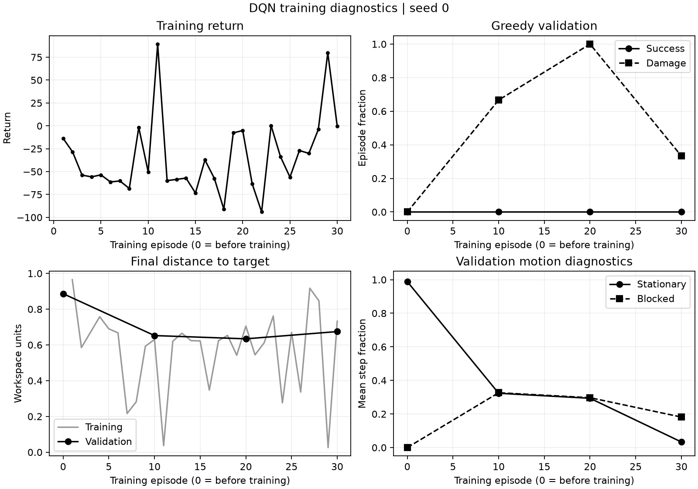

# Attempt 002: Initialize replay with reference trajectories

**Status:** completed; no reliable improvement in greedy validation success.

**Run identifier:** `multiroute_replay_seeded_20261110`.

**Execution time:** 10 November 2026, 08:14:05.469069 to 08:20:49.095204 UTC,
as recorded in [run_status.json](002_reference_replay/evidence/run_status.json).

## Question

Attempt 001 obtained no successful training episodes. Does providing a small
number of successful trajectories help the same DQN learn a useful policy?
This attempt changes the initial replay contents only. It does not change the
network, reward, online episode budget, exploration schedule or update schedule.
There is no behavior-cloning loss or pretraining weight update.

## Protocol fixed before observing results

- Environment: `configs/environment_multiroute.yaml`.
- Network: `configs/dqn_multiroute_pilot.yaml`.
- Schedule: `configs/training_multiroute_replay_seeded.yaml`.
- Online training: 30 episodes, scene seeds 0--29, network/exploration seed 0.
- Demonstrations: one reference attempt per seed 10000--10009, using a separate
  environment with the same reset and physics settings. Keep only successful
  complete trajectories, but retain a record of all attempted seeds.
- Validation and checkpoint selection: seeds 100000--100002, before training
  and at episodes 10, 20 and 30, matching attempt 001. No final test seeds used.
- Replay sampling remains uniform. Demonstrations are neither protected from
  later eviction nor forced into each minibatch. Capacity is 20000; no eviction
  is expected within this short pilot.
- Success, damage, budget exhaustion, final distance and movement diagnostics
  determine interpretation. Training loss alone does not establish success.

The comparison holds the *online episode budget* fixed, not the actual action
or optimizer-update count: earlier termination can change both. Demonstrations
are additional training data from a planner with geometry access. Report their
actions separately. Collection counts exclude planner search and reset-time
feasibility probes; they are not total simulator work or an equal-data comparison.

## Commands

From the repository root, with the declared Python environment activated:

```powershell
python -u scripts/train_dqn.py --config configs/environment_multiroute.yaml --dqn-config configs/dqn_multiroute_pilot.yaml --training-config configs/training_multiroute_replay_seeded.yaml --output-dir results/training/multiroute_replay_seeded_20261110
python scripts/summarize_training.py --run-dir results/training/multiroute_replay_seeded_20261110
python scripts/evaluate_dqn.py --checkpoint results/training/multiroute_replay_seeded_20261110/best.pt --episodes 3 --seed 100000
python scripts/archive_training_attempt.py --run-dir results/training/multiroute_replay_seeded_20261110 --output-dir docs/experiments/002_reference_replay/evidence
```

The actual run used `.venv/Scripts/python.exe`. Its `provenance.json` records
UTC launch time, arguments, packages, Git base revision and source SHA-256 hashes.
The run started from base commit `581cd65` with the initializer changes in the
working tree; implementation commit `d2f6fbb` retains those changes. All hashed
source/configuration inputs remained unchanged during the run. The base
revision alone therefore does not identify the executed source; use the
[source hashes](002_reference_replay/evidence/provenance.json) as well.

## Implementation checks

Before launch, 28 focused tests passed for actual demonstration transitions,
final observations and end flags, failure/partial-collection records, replay
capacity protection, seed separation, unchanged weights and exploration RNG,
training/reload integration, and provenance/completion/failure recording.
Existing training and validation regression checks also passed (21 tests).
The complete suite subsequently passed all 166 tests, and Ruff passed.
After training, `best.pt` was reloaded independently. Its episode-30 validation
matched both the saved checkpoint metadata and final run summary exactly, and
its SHA-256 matched the completion record. These checks are retained in
[checkpoint_verification.json](002_reference_replay/checkpoint_verification.json).

Each started training run records its status. Demonstration collection writes
progress after each completed trajectory and on handled interruption, preserving
previously collected evidence. Hard process termination can leave `running`
status and the last saved snapshot; it must not be described as completed.

## Results and interpretation

All ten reference attempts succeeded without damage and supplied 421 replay
transitions. Their seeds were 10000 through 10009, and none of these transitions
came from validation scenes. Collection made zero optimizer updates. The
online run then completed 30 episodes, 4310 environment actions and 1014
optimizer updates. The final replay contained all 4731 collected transitions;
there was no capacity eviction. The collection count excludes reference
certification probes and planner search, as specified above.

The resolved environment and network settings matched attempt 001, and the
initial greedy validation results matched exactly. The changed training fields
enable demonstration collection; the online schedule remains the same.

| Measured quantity | Attempt 001: from scratch | Attempt 002: reference replay |
| --- | ---: | ---: |
| Online episodes | 30 | 30 |
| Additional demonstration transitions | 0 | 421 |
| Online environment actions | 3936 | 4310 |
| Optimizer updates | 921 | 1014 |
| Online training successes | 0/30 | 2/30 |
| Online training damage episodes | 15/30 | 12/30 |
| Final greedy validation successes | 0/3 | 0/3 |
| Final greedy validation damage episodes | 0/3 | 1/3 |
| Final greedy validation mean return | -61.3147 | -66.5331 |
| Final greedy validation mean target distance | 0.7034 | 0.6747 |

Online training succeeded at episodes 11 and 29, corresponding to scene seeds
10 and 28. Episode 11 took 169 actions, returned 89.3543 and had peak normalized
deformation 0.3391. Episode 29 took 60 actions, returned 79.8565 and had peak
normalized deformation 0.9062. These trajectories were collected with
epsilon-greedy exploration, so they do not demonstrate that the greedy policy
can reliably reproduce the behavior. The final exploration epsilon was 0.1.

The repeated development validation results were:

| Greedy policy | Successes | Damage episodes | Budget exhaustion episodes | Mean return | Mean final target distance |
| --- | ---: | ---: | ---: | ---: | ---: |
| Before training | 0/3 | 0/3 | 3/3 | -0.4682 | 0.8865 |
| Episode 10 | 0/3 | 2/3 | 1/3 | -68.8014 | 0.6523 |
| Episode 20 | 0/3 | 3/3 | 0/3 | -86.0355 | 0.6341 |
| Episode 30 | 0/3 | 1/3 | 2/3 | -66.5331 | 0.6747 |

At the final checkpoint, seeds 100000 and 100001 exhausted all 200 actions.
Seed 100002 ended with damage after 28 actions, with peak normalized
deformation 1.0038. Thus a somewhat smaller final distance did not imply a safer
or successful policy. Episode 20 illustrates the same limitation: its lower
mean final distance coincided with damage in every validation scene.



Providing successful trajectories made successful transitions available in
replay, and two online exploratory episodes reached the target. However, none
of the evaluated greedy policies succeeded, and final validation return and
damage were worse than the from-scratch pilot. The evidence does not establish
a reliable improvement from this initializer. It also does not show that
demonstration data is ineffective in general: this is one seed, ten reference
trajectories and a short training run with uniform replay sampling.

One remaining hypothesis is that a small initial set of successes receives too
little training to propagate useful values along the full routes. A next
controlled trial could add a fixed, explicitly counted number of DQN updates
on the same demonstration data before online interaction, with the reward,
network and seed split unchanged. That would change the optimization budget
and must be recorded as a separate attempt. It has not been run here, and the
present evidence does not establish insufficient value propagation as the
cause of failure. Reward design, observation representation and exploration
also remain possible contributors.

No untouched final test or broad robustness evaluation was performed. This
checkpoint is not presented as a fully trained functional final-project model.

## Retained evidence

- [Resolved settings](002_reference_replay/evidence/settings.json),
  [provenance](002_reference_replay/evidence/provenance.json) and
  [completion/checkpoint hashes](002_reference_replay/evidence/run_status.json).
- [All demonstration attempts](002_reference_replay/evidence/demonstrations.json),
  including their actual step counts, rewards and terminal outcomes.
- [All online episode and validation records](002_reference_replay/evidence/metrics.jsonl).
- [Run summary](002_reference_replay/evidence/summary.json) and
  [diagnostic analysis](002_reference_replay/evidence/analysis.json).
- [Archive manifest](002_reference_replay/evidence/archive_manifest.json),
  which identifies the preserved evidence files and their hashes.

Weights and the console log remain in
`results/training/multiroute_replay_seeded_20261110`. Evidence was archived
separately from these larger local outputs.
