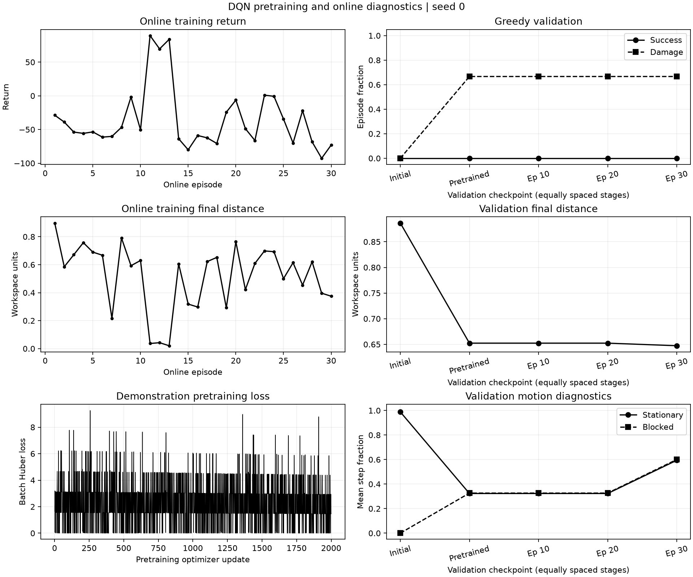

# Attempt 003: DQN pretraining on the same reference data

**Status:** completed; extra TD pretraining did not establish a greedy-validation benefit.

**Run identifier:** `multiroute_pretrained_20261110`.

**Execution time:** 10 November 2026, 08:37:35.574524 to 08:47:01.393110 UTC.
Implementation and the predeclared protocol were committed and pushed as
`ef61903` before launch. All recorded source hashes remained unchanged during
the run.

## Question and controlled change

Attempt 002 provided 421 successful reference transitions but did not produce
a successful greedy validation policy. This attempt asks whether additional
training on those demonstrations before online interaction helps the DQN.

The only added training stage is 2000 ordinary DQN TD updates on demonstration
data. The reward, architecture, batch size, target synchronization interval,
online exploration schedule, warm-up and 30-episode budget remain unchanged.
There is no supervised imitation term, prioritized sampling, curriculum or
new demonstration seed. This is a diagnostic TD-pretraining experiment, not
DQfD, and it does not guarantee imitation of the reference actions.

The hypothesis is that successful outcomes need more updates to influence
earlier decisions. An alternative explanation remains possible: maximizing
next-state Q values over actions absent from demonstrations can produce poor
action choices. Training loss alone cannot resolve this question.

## Protocol fixed before the run

| Setting | Value |
| --- | --- |
| Environment | `configs/environment_multiroute.yaml` |
| Network | `configs/dqn_multiroute_pilot.yaml` |
| Training schedule | `configs/training_multiroute_pretrained.yaml` |
| Demonstration scenes | Seeds 10000--10009, matching attempt 002 |
| Pretraining | 2000 updates, batch size 64, existing DQN TD loss |
| Pretraining sampler | Independent NumPy SeedSequence `[0, 1]` |
| Online training | 30 episodes, seeds 0--29, initialization/exploration seed 0 |
| Development validation | Seeds 100000--100002 |
| Validation checkpoints | Initial, after pretraining, after online episodes 10/20/30 |

Reference trajectories are regenerated through the same seeded environment and
physics. Their collection records matched attempt 002 exactly, confirming the
same 421-transition data budget. Initial validation also matched attempt 002
exactly before learning. The recorded environment, network and existing online
training settings remain unchanged.

Pretraining does not advance online action counters, consume the online replay
sampler or consume the agent's exploration RNG. Its optimizer and target-network
states continue into online training. Total optimizer updates include both
stages; each stage is also reported separately. The existing 256-action online
warm-up still applies. The demonstration data is ordinary uniformly sampled
replay during subsequent online training.

`pretrained.pt` preserves the policy after pretraining. To retain the existing
checkpoint-selection rule, `best.pt` compares only online validation checkpoints
at episodes 10/20/30; `latest.pt` is the last online checkpoint. Report the
pretrained and online results explicitly, including deterioration if observed.
These are inference checkpoints, not exact training-resume snapshots.

This run has the same online episode budget as attempt 002 and adds a stage of
2000 pretraining optimizer updates. Actual online action and update counts
can differ because episode lengths depend on the policy. Demonstration
collection actions are reported separately and exclude planner search and
reset feasibility probes. No final test scenes were used or selected based on
this trial.

## Reproduction commands

Run from the repository root in the declared Python environment. Use a new
output directory to avoid overwriting a previous attempt.

```powershell
python -u scripts/train_dqn.py --config configs/environment_multiroute.yaml --dqn-config configs/dqn_multiroute_pilot.yaml --training-config configs/training_multiroute_pretrained.yaml --output-dir results/training/multiroute_pretrained_20261110
python scripts/summarize_training.py --run-dir results/training/multiroute_pretrained_20261110
python scripts/evaluate_dqn.py --checkpoint results/training/multiroute_pretrained_20261110/pretrained.pt --episodes 3 --seed 100000
python scripts/evaluate_dqn.py --checkpoint results/training/multiroute_pretrained_20261110/best.pt --episodes 3 --seed 100000
python scripts/archive_training_attempt.py --run-dir results/training/multiroute_pretrained_20261110 --output-dir docs/experiments/003_demonstration_pretraining/evidence
```

The actual run used `.venv/Scripts/python.exe`. Provenance records retain its
arguments, dependency versions, UTC launch time, Git revision and source hashes.
Pretraining progress is saved every 100 updates and on handled interruption;
completed per-update records are retained in `pretraining_metrics.jsonl`.

The complete automated suite passed 181 tests and Ruff passed before launch.
Checks include pretraining state isolation, update accounting, target-network
synchronization, partial-failure records, checkpoint metadata and disabled-mode
behavior. The extra validation stage does not write transitions into replay.

After the run, `pretrained.pt` (episode 0, 2000 total updates) and `best.pt`
(online episode 10, 2281 total updates) were independently reloaded. Both
reproduced their saved validation results exactly, and both checkpoint hashes
matched the completion record. All 12 archived evidence-file hashes were also
verified. These checks and the unchanged-source/data checks are retained in
[checkpoint_verification.json](003_demonstration_pretraining/checkpoint_verification.json).

## Results

Pretraining completed all 2000 requested updates using 421 transitions and
batch size 64. The target network synchronized ten times. This stage collected
no additional environment transitions and made no online exploration actions.

The immediate post-pretraining greedy validation completed with 0/3 successes,
2/3 damage episodes and 1/3 budget-exhaustion episodes. Mean return was -68.8014
and mean final target distance was 0.6523. Seed 100000 exhausted its 200-action
budget, while seeds 100001 and 100002 both ended with damage after 28 actions.
Thus pretraining alone has not produced a successful policy on these three
development validation scenes.

The first and last recorded pretraining batch losses were 1.6555 and 1.4755.
They were measured on different randomly sampled batches and are not a paired
measure of learning progress. Task completion and damage remain the criteria
for interpreting policy performance.

Online training completed 30 episodes and 3772 environment actions, with 880
further optimizer updates. The total was therefore 2880 updates: 2000 from
pretraining and 880 online. The replay contained 4193 transitions, comprising
421 demonstration transitions and 3772 online transitions, with no capacity
eviction. The final exploration epsilon was 0.151525.

| Measured quantity | Attempt 001: from scratch | Attempt 002: reference replay | Attempt 003: reference replay and TD pretraining |
| --- | ---: | ---: | ---: |
| Online episodes | 30 | 30 | 30 |
| Demonstration transitions | 0 | 421 | 421 |
| Online environment actions | 3936 | 4310 | 3772 |
| Pretraining optimizer updates | 0 | 0 | 2000 |
| Online optimizer updates | 921 | 1014 | 880 |
| Total optimizer updates | 921 | 1014 | 2880 |
| Online training successes | 0/30 | 2/30 | 3/30 |
| Online training damage episodes | 15/30 | 12/30 | 15/30 |
| Final greedy validation successes | 0/3 | 0/3 | 0/3 |
| Final greedy validation damage episodes | 0/3 | 1/3 | 2/3 |
| Final greedy validation mean return | -61.3147 | -66.5331 | -96.2320 |

The three successful online episodes were 11, 12 and 13, corresponding to
scene seeds 10, 11 and 12. They used 169, 198 and 65 actions respectively,
returned 89.3543, 69.6518 and 83.7277, and had peak normalized deformation
0.3391, 0.7686 and 0.4899. These episodes still used epsilon-greedy exploration;
their success does not establish that the greedy policy can reproduce them.

| Greedy policy | Successes | Damage episodes | Budget exhaustion episodes | Mean return | Mean final target distance |
| --- | ---: | ---: | ---: | ---: | ---: |
| Before training | 0/3 | 0/3 | 3/3 | -0.4682 | 0.8865 |
| After 2000 pretraining updates | 0/3 | 2/3 | 1/3 | -68.8014 | 0.6523 |
| Online episode 10 | 0/3 | 2/3 | 1/3 | -68.8014 | 0.6523 |
| Online episode 20 | 0/3 | 2/3 | 1/3 | -68.8014 | 0.6523 |
| Online episode 30 | 0/3 | 2/3 | 1/3 | -96.2320 | 0.6473 |

The post-pretraining, episode-10 and episode-20 per-scene validation records
were identical. This establishes identical measured outcomes on these scenes,
not identical network weights. The selection rule retains the first strictly
best online score, so the tie at episode 20 does not replace episode 10.
The reloaded `best.pt` metadata confirms that episode 10 was retained; the
final episode-30 checkpoint is stored separately as `latest.pt`.

The final policy deteriorated in validation return. Seed 100000 ended with
damage after 143 actions, including 119 stationary and 121 blocked actions.
Seed 100001 exhausted 200 actions, including 190 stationary and 191 blocked
actions. Seed 100002 ended with damage after 28 actions. Mean stationary and
blocked fractions were 0.5941 and 0.6004 respectively. These observations
indicate substantial unproductive contact or blocked motion in the final
validation rollouts, despite the three exploratory training successes.



## Interpretation and next hypothesis

Providing 2000 extra ordinary DQN updates on the same demonstration data did
not produce successful greedy validation behavior. The final validation return
and damage count were worse than in attempt 002. The increase from two to three
exploratory training successes is not evidence of a reliable policy improvement.
This run therefore does not validate extra TD pretraining as a sufficient fix.

The experiment still does not identify a single cause of failure. Extra
optimization, a limited demonstration set, value estimates for unobserved
actions, observation representation and reward incentives remain possible
contributors. One training seed and three development validation scenes cannot
establish convergence, generalization or a general failure of demonstration
learning. No untouched final test or broad robustness evaluation was performed.
None of these checkpoints is presented as a functional final-project model.

A next controlled experiment could add an explicit supervised action loss on
the existing demonstrations, encouraging the policy to prefer demonstrated
actions while keeping the reward, scene distribution and data split fixed.
This is an untested hypothesis, not a result of attempt 003. It should be
recorded separately, with its loss weight and update budget specified in
advance, and evaluated both before and after online training.

## Retained evidence

- [Resolved settings](003_demonstration_pretraining/evidence/settings.json),
  [source provenance](003_demonstration_pretraining/evidence/provenance.json) and
  [completion/checkpoint hashes](003_demonstration_pretraining/evidence/run_status.json).
- [All demonstration attempts](003_demonstration_pretraining/evidence/demonstrations.json).
- [Pretraining summary](003_demonstration_pretraining/evidence/pretraining.json)
  and [all pretraining update records](003_demonstration_pretraining/evidence/pretraining_metrics.jsonl).
- [Post-pretraining validation](003_demonstration_pretraining/evidence/pretraining_validation.json)
  and [all online episode/validation records](003_demonstration_pretraining/evidence/metrics.jsonl).
- [Run summary](003_demonstration_pretraining/evidence/summary.json),
  [diagnostic analysis](003_demonstration_pretraining/evidence/analysis.json) and
  [archive manifest](003_demonstration_pretraining/evidence/archive_manifest.json).

The inference checkpoints and console log remain in
`results/training/multiroute_pretrained_20261110`. The archive retains the small
evidence files needed to review this unsuccessful attempt.
