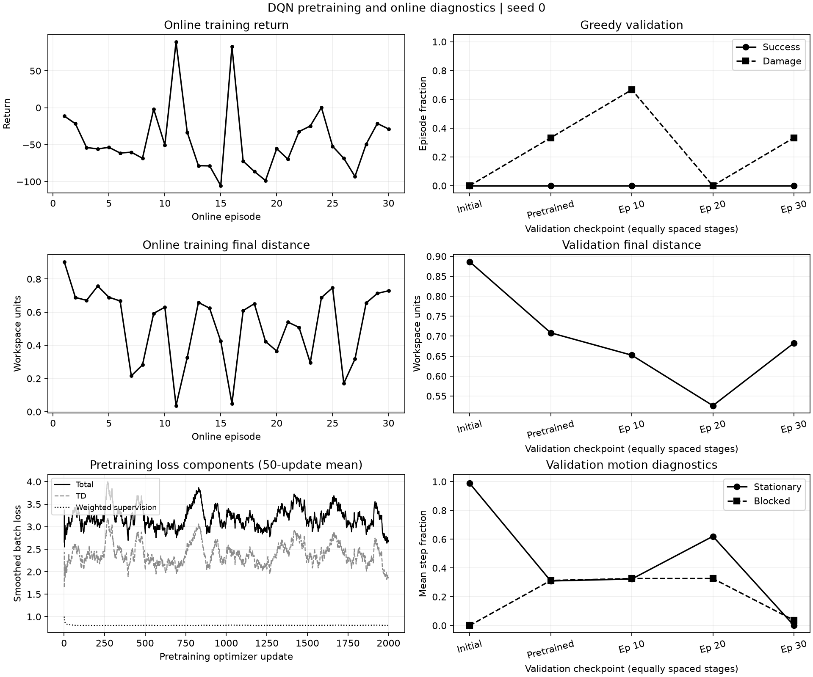

# Attempt 004: Supervised action margins during demonstration pretraining

**Status:** completed; no successful greedy validation policy was obtained.

**Run identifier:** `multiroute_supervised_20261110`.

**Execution time:** 10 November 2026, 09:02:03.621450 to 09:08:11.602611 UTC,
as recorded in [run_status.json](004_supervised_pretraining/evidence/run_status.json).

## Question and single training change

Attempt 003 added 2000 TD-only demonstration updates, but all greedy validation
checkpoints still had zero successes. This attempt adds a supervised action
margin to those same 2000 pretraining updates. It asks whether explicitly
preferring the demonstrated action improves the policy before and after online
interaction. The environment, reward, architecture, demonstration seeds,
pretraining sampler and online schedule remain unchanged.

For a demonstration action `a_demo`, the supervised objective is
`mean(max_a[Q(s,a) + margin(a_demo,a)] - Q(s,a_demo))`, where the margin is zero
for the demonstrated action and 0.8 for each other action. The combined
pretraining objective is `TD_Huber_loss + 1.0 * supervised_margin_loss`.
Weight 1.0 and margin 0.8 are fixed before the trial and are not claimed to be
optimal. The existing Adam optimizer, gradient clipping and target-network
synchronization schedule are retained.
The margin is a soft training penalty and does not guarantee the learned
Q values will satisfy that separation on every observation.

The large-margin objective follows the idea in Hester et al.,
[Deep Q-learning from Demonstrations (AAAI 2018)](https://arxiv.org/abs/1704.03732).
The objective is implemented in the project's existing PyTorch learner; no
external DQfD implementation is imported. This is a limited component experiment,
not the full DQfD algorithm: the code retains ordinary one-step DQN, uniform
replay, and no added n-step loss, prioritized replay or L2 regularization term.

Only demonstration pretraining uses the supervised loss. Online updates remain
ordinary DQN, including updates whose uniformly sampled batch happens to contain
demonstrations. Random exploratory actions are never used as expert labels.
If the post-pretraining policy improves but subsequently deteriorates, retain
that evidence rather than selecting only the favorable stage.

## Protocol fixed before the run

| Setting | Value |
| --- | --- |
| Environment | `configs/environment_multiroute.yaml` |
| Network | `configs/dqn_multiroute_pilot.yaml` |
| Schedule | `configs/training_multiroute_supervised.yaml` |
| Demonstration scenes | Seeds 10000--10009; expected 421 transitions |
| Pretraining | 2000 updates; batch size 64 |
| Supervised weight and margin | 1.0 and 0.8; pretraining only |
| Pretraining sampler | Independent SeedSequence `[0, 1]`, matching attempt 003 |
| Online training | 30 episodes; seeds 0--29; initialization/exploration seed 0 |
| Development validation | Seeds 100000--100002; greedy actions |
| Validation stages | Initial; pretrained; online episodes 10, 20 and 30 |

Regenerate demonstrations through actual environment transitions, compare their
records with attempt 003, and verify identical initial validation. The online
warm-up remains 256 actions, with one update every four actions and epsilon
decaying from 1.0 to 0.1 over 4000 actions. Pretraining does not advance either
online counter or consume the exploration/online replay RNG streams. Optimizer
and target-network states carry forward into online training.

This trial matches attempt 003's planned pretraining and online episode budgets.
It adds computation for the supervised term, and actual online action/update
counts may differ because policies terminate at different times. Report both
stages and the additional demonstration collection cost explicitly. Collection
actions exclude planner search and reset feasibility probes.

`pretrained.pt` records the policy after supervised pretraining; `best.pt`
continues to select only among online validation checkpoints, with success rate
then mean return determining the score. `latest.pt` is the final online policy.
All are inference checkpoints. These development validation scenes are not a
final held-out test set, and no final test is used in this attempt.

## Commands

Run from the repository root using the declared Python environment and a new
output directory. The actual local interpreter is `.venv/Scripts/python.exe`.

```powershell
python -u scripts/train_dqn.py --config configs/environment_multiroute.yaml --dqn-config configs/dqn_multiroute_pilot.yaml --training-config configs/training_multiroute_supervised.yaml --output-dir results/training/multiroute_supervised_20261110
python scripts/summarize_training.py --run-dir results/training/multiroute_supervised_20261110
python scripts/evaluate_dqn.py --checkpoint results/training/multiroute_supervised_20261110/pretrained.pt --episodes 3 --seed 100000
python scripts/evaluate_dqn.py --checkpoint results/training/multiroute_supervised_20261110/best.pt --episodes 3 --seed 100000
python scripts/archive_training_attempt.py --run-dir results/training/multiroute_supervised_20261110 --output-dir docs/experiments/004_supervised_pretraining/evidence
```

## Metrics and interpretation

Record every pretraining update's TD loss, supervised margin loss, combined
loss, gradient norm and pre-update agreement with demonstration actions.
The plot labels any trailing-window smoothing and preserves raw values in
the archived log. First/last 100-batch agreement is a training diagnostic on
reused demonstration states, not held-out accuracy or episode success.

Task success, damage, budget exhaustion and motion diagnostics are evaluated
at all declared stages. A lower supervised loss or higher action agreement
alone does not establish successful rollout behavior. Retain all unsuccessful
episodes and any online deterioration. One initialization and three validation
scenes cannot establish reliability or generalization.

## Results

All ten reference collection attempts succeeded and again supplied 421
transitions. The complete collection records and initial validation results
matched attempt 003 exactly. The resolved environment, network and shared
training settings were unchanged; the new supervised weight and margin were
the declared additional configuration. Implementation commit `52e45db` was
saved before launch, and the recorded source hashes remained unchanged during
the run. Before launch, the full test suite passed 211 tests, and Ruff passed.

Both `pretrained.pt` (2000 updates, before online interaction) and `best.pt`
(online episode 20, 2599 total updates) were independently reloaded. Their
validation results matched the saved metadata and corresponding stage logs
exactly, and their hashes matched the completion record. All 12 archived
evidence files were hash-verified. These checks are retained in
[checkpoint_verification.json](004_supervised_pretraining/checkpoint_verification.json).
The final episode-30 model remains separately saved as `latest.pt`.

Pretraining completed all 2000 requested updates and ten target-network
synchronizations. Its combined first/last batch losses were 2.6574 and 2.3717.
These came from different sampled batches, so their difference is not a paired
measure of policy improvement. Mean pre-update agreement with demonstration
actions was 26.5313% over the first 100 sampled batches and 37.6094% over the
last 100. These values concern reused training states and are neither held-out
classification accuracy nor rollout success rates.

Online interaction then completed 30 episodes and 4385 environment actions,
with 1033 additional optimizer updates. Total updates were 3033: 2000
pretraining plus 1033 online. Replay contained all 4806 transitions, including
the 421 demonstrations, with no capacity eviction. The final exploration
epsilon was 0.1. The unchanged 30-episode budget therefore produced more
online actions and updates than attempt 003; this is not an equal-action or
equal-total-compute comparison.

| Measured quantity | Attempt 003: TD pretraining | Attempt 004: TD and supervised margin |
| --- | ---: | ---: |
| Online episodes | 30 | 30 |
| Demonstration transitions | 421 | 421 |
| Pretraining optimizer updates | 2000 | 2000 |
| Online environment actions | 3772 | 4385 |
| Online optimizer updates | 880 | 1033 |
| Total optimizer updates | 2880 | 3033 |
| Online training successes | 3/30 | 2/30 |
| Online training damage episodes | 15/30 | 12/30 |
| Post-pretraining validation successes | 0/3 | 0/3 |
| Post-pretraining validation damage episodes | 2/3 | 1/3 |
| Final validation successes | 0/3 | 0/3 |
| Final validation damage episodes | 2/3 | 1/3 |
| Final validation mean return | -96.2320 | -78.4671 |

The successful exploratory training episodes were 11 and 16, corresponding to
scene seeds 10 and 15. They took 169 and 152 actions, returned 89.3543 and
82.9404, and reached peak normalized deformations of 0.3391 and 0.7792.
Their exploration epsilons were approximately 0.652 and 0.491, respectively.
These successes do not establish that the greedy policy can repeat the routes.

| Greedy policy | Successes | Damage episodes | Budget exhaustion episodes | Mean return | Mean final target distance |
| --- | ---: | ---: | ---: | ---: | ---: |
| Before training | 0/3 | 0/3 | 3/3 | -0.4682 | 0.8865 |
| After supervised pretraining | 0/3 | 1/3 | 2/3 | -41.7432 | 0.7084 |
| Online episode 10 | 0/3 | 2/3 | 1/3 | -68.8014 | 0.6523 |
| Online episode 20 | 0/3 | 0/3 | 3/3 | -49.8637 | 0.5259 |
| Online episode 30 | 0/3 | 1/3 | 2/3 | -78.4671 | 0.6828 |

Immediately after pretraining, seed 100000 exhausted its budget with 186
stationary and 188 blocked actions; seed 100001 traveled 5.0350 units but still
finished 0.7966 units from the target; seed 100002 incurred damage after 17
actions. Thus a lower mean return penalty than attempt 003 did not correspond
to completing a route.

Episode 20 had the best online validation score under the declared selection
rule. It avoided damage in all three scenes, but every episode exhausted its
200-action budget. Seed 100000 ended 0.2142 units from the target with 178
stationary actions; seed 100002 had 194 stationary and 195 blocked actions.
This is incomplete task behavior, despite the lower damage count and distance.

The final policy performed worse than the episode-20 policy in return and
damage. Seeds 100000 and 100001 exhausted their budgets after traveling 5.0786
and 5.0630 units, while seed 100002 incurred damage after 111 actions. No final
validation episode was stationary by the recorded motion threshold, yet none
reached the target. Movement alone again did not indicate task completion.



## Post-hoc check on the known demonstration states

After the declared trial, an additional read-only diagnostic froze
`pretrained.pt` and regenerated the same 421 demonstration transitions. The
collection records and source hashes matched the training run. This check used
training states only, performed no optimizer updates and did not change the
model or training logs. Regeneration required 421 additional environment
actions, reported separately from the training budgets above; this count also
excludes planner search and reset-time feasibility probes.

| Diagnostic on the frozen pretrained model | Observed value |
| --- | ---: |
| Greedy agreement with all demonstration labels | 125/421 (29.6912%) |
| Always predicting the most frequent label, east-large | 111/421 (26.3658%) |
| Predictions of south-small | 356/421 (84.5606%) |
| Large-action predictions | 0, despite 186 large-action demonstration labels |
| Observations satisfying the prescribed 0.8 margin | 0/421 |
| Mean margin violation | 0.8096 |

This establishes weak agreement with the known reference action labels and a
strong concentration of predictions on one action. It is therefore premature
to describe the problem only as failure to generalize to unseen scenes. This
diagnostic does not identify why fitting is weak, and disagreement with one
demonstrated action is not itself proof that every alternative action is wrong.

The 29.6912% frozen-model figure and the 37.6094% last-100-batch figure measure
different things. The latter averages sampled batches evaluated by changing
models before their updates; the former evaluates one saved model on the whole
corpus. They must not be substituted for one another or treated as validation
success rates.

The [diagnostic script](004_supervised_pretraining/diagnose_demonstration_fit.py)
and [full counts and provenance](004_supervised_pretraining/demonstration_fit.json)
are retained. To repeat the check, use a new output path:

```powershell
python docs/experiments/004_supervised_pretraining/diagnose_demonstration_fit.py --run-dir results/training/multiroute_supervised_20261110 --output results/training/multiroute_supervised_20261110/demonstration_fit_recheck.json
```

## Interpretation and next diagnostic

The added supervised margin changed training and validation behavior, but
produced no successful greedy validation episode at any declared checkpoint.
Compared with attempt 003, post-pretraining and final validation each had one
fewer damage episode and a less negative mean return. With only three reused
development scenes, those differences do not establish a reliable safety or
generalization improvement. The task-success requirement remains unmet, and
none of these checkpoints is presented as a functional final-project model.

Both sampled and frozen-model demonstration agreement remained limited. The
action-frequency diagnostic above now motivates a focused check of whether
the network can fit a small, controlled set of demonstration states before
enlarging the training budget.
A model that cannot learn the basic decision pattern on training scenes needs
a different diagnosis from one that learns them but fails on new scenes.
Following that check, a curriculum could retain the three-region task and
341-dimensional observation while first widening passages and reducing
randomization, then restoring the current difficulty. These are proposed
diagnostics and future experiments, not established fixes from this run.

The present trial does not isolate the ultimate cause of failure. Limited
demonstration diversity, action-label imbalance, representation, loss balance
and online learning without continued supervision remain hypotheses. No loss
weight, margin or update budget was changed after observing the results.
No untouched final test or broad robustness evaluation was performed.

## Retained evidence

- [Resolved settings](004_supervised_pretraining/evidence/settings.json),
  [source provenance](004_supervised_pretraining/evidence/provenance.json) and
  [completion/checkpoint hashes](004_supervised_pretraining/evidence/run_status.json).
- [All reference collection attempts](004_supervised_pretraining/evidence/demonstrations.json).
- [Pretraining summary](004_supervised_pretraining/evidence/pretraining.json)
  and [all component-loss/update records](004_supervised_pretraining/evidence/pretraining_metrics.jsonl).
- [Post-pretraining validation](004_supervised_pretraining/evidence/pretraining_validation.json)
  and [all online episode/validation records](004_supervised_pretraining/evidence/metrics.jsonl).
- [Run summary](004_supervised_pretraining/evidence/summary.json),
  [diagnostic analysis](004_supervised_pretraining/evidence/analysis.json) and
  [archive manifest](004_supervised_pretraining/evidence/archive_manifest.json).
- [Post-hoc frozen-model demonstration fit](004_supervised_pretraining/demonstration_fit.json)
  and its [reproduction script](004_supervised_pretraining/diagnose_demonstration_fit.py).
- [Independent checkpoint and evidence verification](004_supervised_pretraining/checkpoint_verification.json).

Model weights and the raw console log remain in
`results/training/multiroute_supervised_20261110`. Compact evidence preserves
the unsuccessful outcome alongside the partial changes in behavior.
