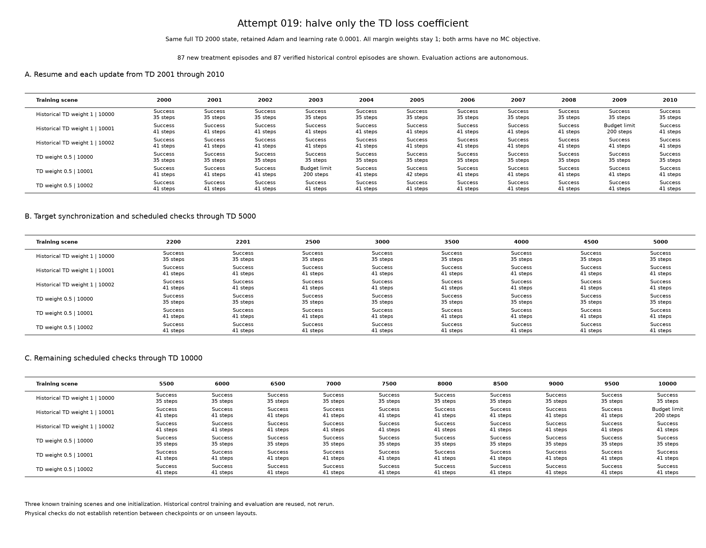
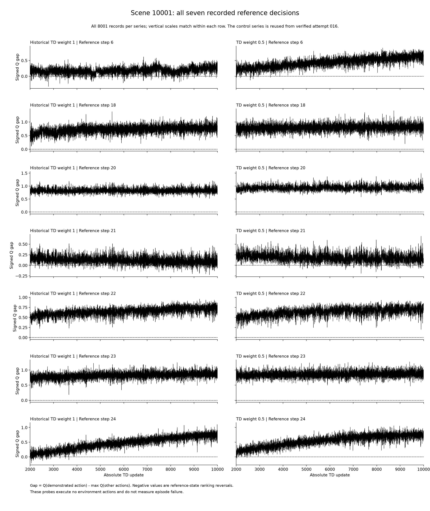

# Attempt 019: reduce the TD objective coefficient while retaining Adam

## Protocol recorded before execution

Attempt 018 diagnosed opposed TD and margin gradients at 25 of 28 selected
historical states and showed that retained Adam moments can change the direction
of a fragile action-gap update. Removing TD in one-step counterfactuals recovered
some local rankings but was not a universal remedy. Those retrospective findings
motivate a sustained single-factor comparison; they do not establish that a
smaller TD coefficient will preserve complete episodes.

The requested treatment changes **only the TD loss coefficient from 1 to 0.5**.
Use the verified attempt-016 baseline as the historical control, without the
MC constraint tested in attempt 017 or the local weighting tested in attempt 016.

For the same ordered batch of 117 demonstration transitions:

- Historical control: `mean(TD Huber) + mean(demonstration margin)`.
- New treatment: `0.5 * mean(TD Huber) + mean(demonstration margin)`.

All supervised sample coefficients remain 1, with margin 0.8. Each term retains
its mean over 117 transitions. Do not divide the combined objective by 1.5,
duplicate data, blend targets, add an actual-return loss, or change the common
learning rate. Actual discounted demonstration returns are reused only for
evaluation and calibration-error reporting. They are not part of the optimized
objective. Fix the TD coefficient at 0.5 before execution; do not retune it in
response to failures or intermediate successes.

## Exact continuation and unchanged conditions

Restore the original successful **TD-2000 full snapshot**, including online and
target networks, Adam first and second moments and parameter step counters, both
RNG states, and absolute TD clock. The inherited branch contains 20000 supervised
updates, 20000 actual-return calibration updates and 2000 TD updates. Adam begins
at step 22000. Do not rerun pretraining, clear moments, reset counters or perform
an extra target synchronization at the boundary.

Keep learning rate 0.0001, gamma 0.99, gradient clipping at 10, target interval
200, the 341/256/256/8 network, environment settings, scene seeds, action and
reward definitions, encoder, and full-batch transition order unchanged. The TD
coefficient changes the combined gradient's direction and magnitude; this is
not a claim that the resulting parameter displacement stays fixed.

Use the same helper/source chain and verified historical control as attempt 017:
attempt-016 baseline at `e51effb2f5e0e05fb70486088d38ab235a395106`, previously
verified to reproduce attempt 014 exactly. Audit its committed archive, original
demonstrations, complete model hashes, raw logs, full starting state and previous
reproduction gate before new training. Reuse its 8000 updates, 87 episodes and
3711 policy actions as **historical evidence**, not newly executed work.

Train exactly 8000 new updates, **TD 2001 through 10000**. The branch ends at
50000 cumulative updates and Adam step 30000. Ordinary target synchronizations
occur at 2200, 2400, ..., 10000. Do not stop early, roll back, freeze the network,
force actions or replace the prescribed final model with a selected checkpoint.
Keep production code and earlier experiment evidence immutable. All new code,
comments and runtime messages are English.

## Evaluation and measurements

Use the original 29 physical checkpoints:

`2000, 2001, 2002, 2003, 2004, 2005, 2006, 2007, 2008, 2009, 2010,
2200, 2201, 2500, 3000, 3500, 4000, 4500, 5000, 5500, 6000, 6500,
7000, 7500, 8000, 8500, 9000, 9500, 10000`.

At each checkpoint, evaluate scenes 10000, 10001 and 10002 with autonomous greedy
network actions, giving 87 new main episodes. Before the first update, require
the exact original successful behavior and full-batch Q values. Record success,
damage, budget exhaustion, return, actions, blocked/stationary behavior, and
first reference-action divergence. Preserve all failures and observed recoveries.
A first divergence is not automatically the cause of a failed continuation.

After every update and at the restored boundary, measure all eight Q values on
scene 10001's fixed demonstrated states at steps **6, 18, 20, 21, 22, 23 and 24**,
using batch-one inference and the original scalar subtraction procedure.
Record `Q(demo) - max(Q(other))`, greedy actions, negative intervals, exact ties,
minima and final gaps. Compare all 8001 records per arm, including the four
neighboring decisions at steps 20--23 and the earlier step 6. These 56007 new
probe forwards execute no environment actions. A reference-state reversal is
not a measured failed episode; later demonstrated states may be unvisited after
the actual trajectory changes.

Keep the original 67 model files: 29 inference checkpoints, 29 full snapshots,
eight otherwise missing target-source snapshots and the final full-state alias.
Log all 8000 updates, including the unweighted TD loss, unweighted supervised
loss, weighted combined loss, coefficient, pre-clipping gradient norm, parameter
change and target synchronization. Before/after TD diagnostics use the same
frozen pre-update Bellman targets. Compare shared unweighted components and
physical outcomes; combined objective values differ by design. Evaluate final
demonstration agreement after updating rather than treating pre-update logged
accuracy as final accuracy. Calibration RMSE is a diagnostic, not an MC term.

## Reset certification and work accounting

Keep `verify_reference_route=True` as in the historical environment. Each reset
may check one or more candidate scenes using a planner and a copied simulation.
Observe the existing reset return information without rerunning checks or
changing observations, RNG state or acceptance behavior. Record every completed
reference-route check and its executed steps, including rejected candidates.

Keep policy episode/action counts comparable to previous attempts. Separately
report reset calls, certification checks and copied-simulation steps, then their
combined executed-action total for the new treatment. Historical policy counts
remain explicitly reused; do not present an unlogged historical certification
total as newly measured. Mark accounting incomplete if a reset fails before
returning its diagnostic information.

## Verification and execution

Meaningful focused tests must verify original-updater equivalence at TD weight 1,
the independently computed 0.5 objective and gradients, unchanged Adam continuity,
correct target timing, coefficient validation before mutation, and reset instrumentation
that preserves returned values and restores the original method.

After the main run, independently implement the weighted objective and replay
updates 2001--2201 for both control and treatment. Compare all update logs, dense
probes and available full states, including the target synchronization at 2200:
**402 additional verification updates**. Audit all later hashes, counters,
diagnostics and target lineage without claiming numerical replay of every main
update.

Reload the new treatment at TD 2000, 2009, 2200, 2201 and 10000 on all three
scenes: **15 additional verification episodes**. Compare exact historical
treatment outcomes and separately count verification policy actions, resets,
certification checks and internal copied-simulation steps. Do not rerun the
historical control's episodes. Analysis and plotting add no optimizer updates
or physical actions.

Run from the repository root:

```powershell
.venv/Scripts/python.exe -u docs/experiments/019_td_weight/run_td_weight.py --reference-run results/training/local_supervision_20261112 --archive-dir docs/experiments/016_local_supervision/evidence --output-dir results/training/td_weight_20261114
.venv/Scripts/python.exe -u docs/experiments/019_td_weight/verify_td_weight.py --run-dir results/training/td_weight_20261114 --output results/training/td_weight_20261114/reload_checks.json
```

Retain the fixed protocol, source and script hashes, all outcomes, dense traces,
training diagnostics, verification results, accounting, and any failed attempts.
Archive compact evidence and English experiment notes in Git, with full binary
snapshots retained locally. Three known scenes and one inherited initialization
do not establish generalization. Sampled physical success does not prove success
between checkpoints. This experiment does not automatically change production
defaults.

Results are pending at the pre-execution protocol commit.

Before execution, 53 focused runner/analysis tests passed in 5.68 seconds, and
Ruff passed for the frozen runner, analyzer, plotter, archive tool and their
completed tests. A read-only source preflight verified 117 transitions, TD 2000,
Adam step 22000, the historical 3711 policy actions, 52 production/configuration
hashes and 14 helper hashes. It performed no optimizer updates or environment
actions. The independent verifier and its tests are developed separately and
must pass before accepting the completed experiment.

## Completed results: 14 November 2026

The pending status above records the pre-execution protocol. The single formal
run subsequently completed TD 2001--10000 without an execution failure, from
05:19:41 to 05:24:49 UTC (307.24 seconds). Its launch commit was
`ea2ce1077d94069aaf662ca5a3b7ae673dbd4240`. Provenance records a dirty working tree,
so the captured script, helper and production/configuration hashes identify the
executed inputs in addition to Git HEAD. The original control was reused from
attempt 016; no new main control training or episodes were run.

Halving the TD coefficient improved the final outcome and the overall sampled
retention count, but **did not achieve uninterrupted retention**. The treatment
introduced an earlier transient failure at TD 2003. Both arms passed nine of the
first ten all-scene checks, so this experiment does not establish an improvement
in that immediate-transition measure.

| Measured outcome | Historical TD weight 1 | New TD weight 0.5 |
| --- | ---: | ---: |
| All three scenes succeed at a physical checkpoint | 27/29 | 28/29 |
| Successful individual scene episodes | 85/87 | 86/87 |
| All-scene success during TD 2001--2010 | 9/10 | 9/10 |
| Failed scene-10001 checkpoints | 2009, 10000 | 2003 |
| Final autonomous scene successes | 2/3 | 3/3 |
| Final full-batch demonstration agreement | 115/117 | 117/117 |
| Final actual-return calibration RMSE | 0.499196 | 0.660312 |

Scenes 10000 and 10002 succeeded at all 29 physical checkpoints in both arms.
The treatment recovered at the next sampled checkpoint, TD 2004, and succeeded
at every remaining scheduled check through TD 10000. Its final three episodes
took 35, 41 and 41 actions, with returns 107.610812, 107.585050 and 107.643380.
No final action overrides or checkpoint selection were used. These observations
do not establish success at the unsampled updates between physical checks.

### The retained failure

At TD 2003, scene 10001 first diverged at step 6: the policy selected
`east_small` instead of demonstrated `south_small`. Their Q values were
75.360214 and 75.335625, respectively, giving a demonstration gap of
**-0.024590**. The episode exhausted its 200-action budget without damage;
return was -104.706068, with 171 blocked and 170 stationary steps. Recorded states
matched the reference prefix up to the decision at step 6. This locates the first
changed decision; an isolated-action rescue
was not performed here, so it does not prove that this decision alone caused
the failed continuation.

The historical first sampled failure was later, at TD 2009, and began at step
21. Therefore, the higher aggregate count must not be described as eliminating
early degradation. The preserved treatment failure is a substantive outcome,
even though the experiment process itself completed successfully.

### Dense reference-state rankings

Each arm has 8001 recorded update states: the shared TD-2000 boundary and all
8000 continuation updates. At each state, seven fixed scene-10001 observations
were evaluated. The following counts exclude the shared boundary and measure
negative demonstration Q gaps, not failed physical episodes.

| Demonstrated step | Negative-gap updates, weight 1 | Negative-gap updates, weight 0.5 | Final gap, weight 1 | Final gap, weight 0.5 |
| --- | ---: | ---: | ---: | ---: |
| 6 | 394 | 18 | 0.255623 | 0.611160 |
| 18 | 0 | 0 | 0.700241 | 0.649956 |
| 20 | 0 | 0 | 0.689560 | 0.952202 |
| 21 | 627 | 153 | -0.059891 | 0.153618 |
| 22 | 0 | 0 | 0.807518 | 0.738251 |
| 23 | 0 | 0 | 0.922073 | 0.891678 |
| 24 | 102 | 5 | 0.802681 | 0.657944 |

The earlier fragile step 6 reversed on 18 treatment updates in 15 intervals,
first at TD 2003 and last at 3866. Step 21 reversed on 153 updates in 127
intervals, first at TD 2717 and last at 9956. All 127 step-21 intervals lay
between the scheduled physical checks. Its minimum gap was -0.189919 at TD
7337, compared with the control minimum of -0.223328. Thus, the final positive
gap does not imply a permanently stable ranking. Steps 20, 22 and 23 retained
the demonstrated greedy action at every dense check in both arms; no new
neighboring action reversals were observed on these monitored inputs.

Rankings were not uniformly better at matched updates: step 21 disagreed with
the demonstration on 143 updates where the historical control agreed. Counts
fell overall because more disagreements disappeared elsewhere in the timeline.
Step 24 was already negative at the shared boundary, adding one negative record
to each arm if that boundary is included. Its known successful deviations also
illustrate why reference agreement and task success are separate measurements.
For example, treatment TD 2005 selected `east_large` instead of `east_small` at
step 24, with gap -0.002548, yet succeeded in 42 actions with return 98.391647.
There were no exact zero-gap ties among the seven monitored inputs in either arm.

### Loss trade-off and optimizer continuity

The restored Q vectors matched the source exactly on all 117 inputs. Before the
first update, both arms had TD loss 0.079081811 and supervised loss 0.063221075.
The weighted objective difference was -0.039540902, consistent with halving only
the TD component under float32 arithmetic. No MC objective was constructed,
sample weight changed or total-loss normalization added.

Across all 8000 updates, mean unweighted TD loss increased from 0.075954 in the
control to 0.099838 in the treatment, while mean supervised margin loss decreased
from 0.049829 to 0.035582. These are pre-update diagnostics; after-update TD
diagnostics use the same frozen targets for that update. Final calibration RMSE
also increased, as shown above. The outcome is consistent with giving action
supervision greater relative influence, with a trade-off in TD and actual-return
fit. It does not show that the lower weighted total loss is directly comparable
between arms or that every update better preserves behavior.

All 8000 treatment parameter updates were nonzero. Both arms retained Adam's
inherited state, advanced its parameter clocks from 22000 to 30000, and performed
40 scheduled target synchronizations. Treatment mean pre-clipping gradient norm
was 15.037230 versus 17.855495; clipping was active on 6426 versus 7149 updates.
Mean parameter displacement per update was 0.002025 versus 0.001959. A smaller
TD coefficient therefore did not simply produce a proportionally smaller Adam
step, and should not be interpreted as another learning-rate reduction.
The first pre-clipping gradient norm actually increased from 11.97046 to
16.00118 despite halving the TD coefficient, consistent with changing the
balance of opposing component gradients rather than uniformly scaling them.

### Verification and actual work

The independent verifier passed on its first execution. It replayed the first
201 continuation updates for each arm using a separate objective implementation,
including target synchronization at TD 2200. It checked matching logs, dense
probes and available full states. All 67 saved model files per arm, later target
lineage, counters and raw evidence were audited; later updates were not all
numerically replayed. Fifteen treatment reload episodes at the five declared
checkpoints reproduced their recorded outcomes and reset-certification records.
The full test suite passed **838 tests in 90.10 seconds**, and Ruff passed.

| Newly executed work | Main treatment | Independent verification | Total |
| --- | ---: | ---: | ---: |
| Optimizer updates | 8000 | 402 | 8402 |
| Policy episodes / environment resets | 87 | 15 | 102 |
| Autonomous policy actions | 3553 | 585 | 4138 |
| Reset certification checks | 87 | 15 | 102 |
| Copied-simulation certification actions | 3393 | 585 | 3978 |
| Total simulator actions | 6946 | 1170 | 8116 |

Reset accounting was complete, with no reset failures or missing diagnostic
records. The main run's 56007 dense probe forwards added no environment actions;
analysis and plotting added no optimizer updates or physical episodes. Unit-test
execution is separate from this work table. The inherited 42000 updates and
historical control's 8000 updates, 87 episodes and 3711 policy actions were reused
and are not included in these newly executed totals. The control's internal
reset-certification action total was not retrospectively invented.

### Interpretation and retained evidence

The coefficient-0.5 treatment is a useful improvement for this long continuation:
it retains all three final routes and reduces the monitored ranking reversals
without introducing reversals at steps 20, 22 or 23. It remains a failed strict
retention test because of the TD-2003 episode, and dense reversals persist late
in training. This evidence covers only three known training scenes and one
inherited initialization. There was no online training, new demonstration
collection or held-out evaluation, and no production default was changed.

The [compact evidence manifest](019_td_weight/evidence/archive_manifest.json)
indexes 24 evidence files, with 25 files and 7753852 bytes including the manifest.
It retains all sampled outcomes, both complete dense series, provenance, source
hashes, reset accounting, verification, validation and figures. Raw update and
probe logs are represented by 170/8000 and 171/8001 sampled records, respectively;
both compact dense analysis series retain all 8001 update states. The archive's
copied bytes, hashes and sample coverage were independently checked. Full raw
update/probe logs and 67 binary model files remain under
`results/training/td_weight_20261114`; the historical control remains in its
original location. The two figures distinguish sampled physical outcomes from
dense reference-state gaps. Both received visual checks. The run, independent
verification and analysis each executed once, with no formal execution failure.

Key records are the [paired analysis](019_td_weight/evidence/q_analysis.json),
[independent verification](019_td_weight/evidence/reload_checks.json),
[work accounting](019_td_weight/evidence/accounting.json) and
[validation record](019_td_weight/evidence/validation.json).




