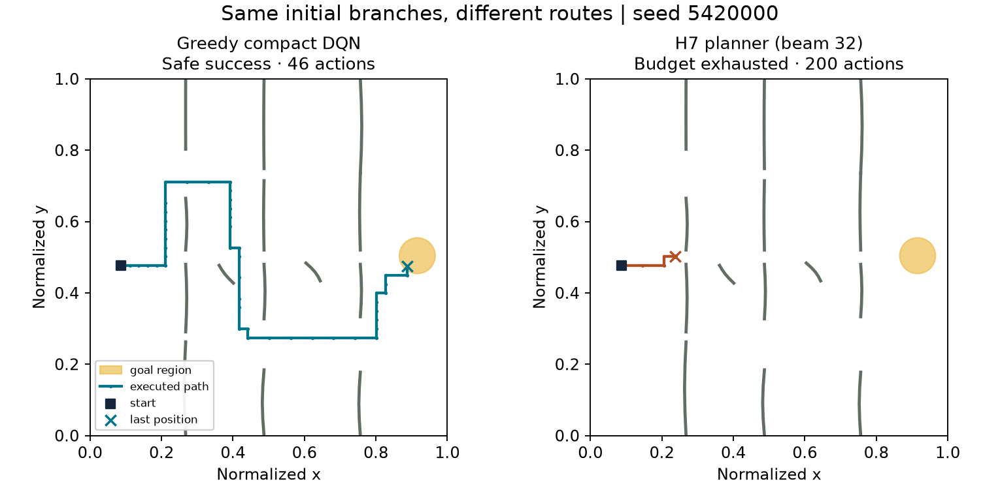

# Results: matched clean layouts

## Main comparison

The table below uses identical layouts for every row, not a separate denominator for each method. 10/10 planned layouts have all five primary methods available. The archive contains 60/60 complete method–layout rollouts across the main experiment and supplement. There are 10,468 executed actions in these traces. Each rollout was evaluated once for comparison; validation repeats are not extra trials.

| Method | Layouts | Success | Damage | Timeout | Steps | Travel | Peak deform. | Return | CPU ms/action | Wall ms/action |
|---|---:|---:|---:|---:|---:|---:|---:|---:|---:|---:|
| DQN | 10 | 10 | 0 | 0 | 46.8 | 1.733 | 0.108 | 106.72 | 0.76 | 1.17 |
| H1 exact | 10 | 0 | 0 | 10 | 200.0 | 1.633 | 0.097 | -16.71 | 61.17 | 64.98 |
| H3 exact | 10 | 0 | 0 | 10 | 200.0 | 0.236 | 0.003 | 1.55 | 424.79 | 452.92 |
| H5 beam 32 | 10 | 0 | 0 | 10 | 200.0 | 0.188 | 0.000 | 1.38 | 79.93 | 94.50 |
| H7 beam 32 | 10 | 0 | 0 | 10 | 200.0 | 0.188 | 0.000 | 1.38 | 81.29 | 97.88 |

Steps, travel, peak and return are episode means, including timeouts. Peak is normalized to the damage limit. CPU/wall time is per executed decision, including repeated states; neither reset time nor offline learning time is included.

Exhaustive H3 on seed 5420006 is especially expensive: 35,240 physical transition cache misses, 3365.6 ms per decision averaged over that episode. This is one reason not to read the time column as a monotonic depth curve. Primary H5/H7 prune the search, and repeated identical decisions are cheap.

## Does beam width change the interpretation?

The original H3 is exhaustive; H5/H7 are not. This additional analysis holds the effective cap at 32 across depths. At H1 all eight alternatives fit. H3 beam 32 is an extra run, not a relabelling of the exhaustive H3. DQN, H1, H5 and H7 rows are reused, not new independent observations.

| Method | Layouts | Success | Damage | Timeout | Steps | Travel | Peak deform. | Return | CPU ms/action | Wall ms/action |
|---|---:|---:|---:|---:|---:|---:|---:|---:|---:|---:|
| DQN | 10 | 10 | 0 | 0 | 46.8 | 1.733 | 0.108 | 106.72 | 0.76 | 1.17 |
| H1 exact | 10 | 0 | 0 | 10 | 200.0 | 1.633 | 0.097 | -16.71 | 61.17 | 64.98 |
| H3 beam 32 | 10 | 0 | 0 | 10 | 200.0 | 0.188 | 0.000 | 1.38 | 69.61 | 95.03 |
| H5 beam 32 | 10 | 0 | 0 | 10 | 200.0 | 0.188 | 0.000 | 1.38 | 79.93 | 94.50 |
| H7 beam 32 | 10 | 0 | 0 | 10 | 200.0 | 0.188 | 0.000 | 1.38 | 81.29 | 97.88 |

On these ten layouts raising the beam planner's depth to seven did not recover a successful approach. This does **not** exclude success at another depth, beam width, terminal heuristic or compute budget. The engineered waypoint used by the DQN is not supplied to the planner; the outcome is a system-level comparison, not proof that learning beats search under identical guidance.

## Independent context: the 100-layout DQN evaluation

The repository's own evaluator gave **81/100 successful, 0 damage, 19 timeouts** on seeds 5420000–5420099, and **31/33 successful, 0 damage, 2 timeouts** on the 33 known layouts. Its ten overlapping episode outcomes and physical metrics match the detailed DQN traces exactly. The ten-layout prefix should not replace the 100-layout number. There are no matched planner results for the other 90 layouts.

## What comparison with a feasible global route shows

On the ten accepted scenes the collision-free A* witness reached the goal each time, with zero contact. DQN mean travel was 1.733 versus A* 1.697; mean steps were 46.8 versus 43.1. The DQN made contact on 6/10 layouts. Its path was strictly shorter on 1/10, tied on 1/10 and longer on 8/10. Distances are in normalized workspace units. These data show **no average path-length advantage from the learned policy** in this subset. Without a no-contact ablation, an individual shorter path is not evidence that contact caused the improvement. A* success is conditional on scene admission, not an unbiased global-planner success rate.

## Why might a deeper search still time out?

The figure uses recorded end-effector positions over the original resting branch shapes. Repeated actions at the same position are drawn on top of one another; they still count toward the 200-step limit.

On seed 5420000 near the first gate, at (0.23803, 0.50155), independently enumerating all depth-three continuations yields a best score of zero for both rightward first actions. The best score starting with either upward move is about −0.000000238; the downward alternatives score lower still. Thus not advancing can be locally competitive under this finite-horizon reward. This is one diagnosed state, not a proof that all failures have the same cause. We did not independently brute-force H5 or H7, nor optimize planner-specific terminal values.

## Audit and limits

- All 49 available outcomes of the earlier pilot reproduce on steps, success, damage, timeout, travel, peak deformation, cumulative reward and contact count. Timing is intentionally not required to be identical.
- See [coverage](tables/coverage.csv), [per-layout metrics](tables/episodes.csv), [per-seed A* comparison](tables/astar_pairs.csv) and [audits](audits/). Missing cells, if any, are not scored as timeouts.
- This is a deterministic, previously used evaluation range, a single checkpoint and one layout family. It is not a blind robustness benchmark and does not test execution noise. There is no matched time-budget, equal-feature ablation, training-cost comparison, real-robot claim or state-of-the-art optimal-planning claim.
